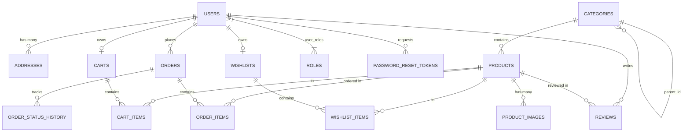

# 🏛️ VEYRO Architecture & System Design Documentation

This document describes the architectural decisions, design patterns, entity-relationship diagrams, and component interactions in the **VEYRO** Full-Stack E-Commerce Marketplace.

---

## 1. System Architecture Overview

VEYRO follows a **3-Tier Layered Architecture** with strict separation of concerns:

```
┌─────────────────────────────────────────────────────────────┐
│                       Client Tier                           │
│     React 18 Single-Page Application (SPA) on Vite          │
│     • Auth, Cart, Wishlist, Toast Contexts                  │
│     • Axios HTTP client with JWT interceptor                │
│     • Component-Driven UI with Vanilla CSS Design System    │
└──────────────────────────────┬──────────────────────────────┘
                               │ HTTPS / JSON REST APIs
                               ▼
┌─────────────────────────────────────────────────────────────┐
│                     Application Tier                        │
│          Spring Boot 3.3.4 (Java 21 LTS Engine)             │
│                                                             │
│   ┌─────────────────────────────────────────────────────┐   │
│   │  Security Filter Chain (JWT Filter, CORS, BCrypt)   │   │
│   └──────────────────────────┬──────────────────────────┘   │
│                              ▼                              │
│   ┌─────────────────────────────────────────────────────┐   │
│   │  Controllers: REST Endpoints (@Valid, DTO mapping)  │   │
│   └──────────────────────────┬──────────────────────────┘   │
│                              ▼                              │
│   ┌─────────────────────────────────────────────────────┐   │
│   │  Service Layer: Transactions (@Transactional, ACID) │   │
│   └──────────────────────────┬──────────────────────────┘   │
│                              ▼                              │
│   ┌─────────────────────────────────────────────────────┐   │
│   │  Persistence Layer: Spring Data JPA + Hibernate 6.5 │   │
│   └──────────────────────────┬──────────────────────────┘   │
└──────────────────────────────┼──────────────────────────────┘
                               │ HikariCP Connection Pool (JDBC)
                               ▼
┌─────────────────────────────────────────────────────────────┐
│                       Database Tier                         │
│             MySQL 8.0 Relational Database                   │
│   • 15 normalized tables with Foreign Keys and Indexes      │
│   • UTF8MB4 charset support                                 │
└─────────────────────────────────────────────────────────────┘
```

---

## 2. Security Architecture

### Stateless JWT Authentication Flow
1. **User Authentication Request**:
   - The user posts credentials (`email`, `password`) to `/api/auth/login`.
2. **Credential Verification**:
   - `AuthenticationManager` invokes `CustomUserDetailsService` to fetch user credentials and verify against the BCrypt salted hash.
3. **Token Generation**:
   - On success, `JwtTokenProvider` signs an HMAC-SHA256 JWT containing user ID, email, roles, issue timestamp, and expiration (`veyro.app.jwtExpirationMs`).
4. **Token Transmission & Storage**:
   - The client stores the JWT in `localStorage` and appends it to all subsequent authenticated requests in the header:
     ```http
     Authorization: Bearer <jwt_token>
     ```
5. **Request Authorization**:
   - `JwtAuthenticationFilter` intercepts each request, parses and validates the token signature, extracts the user principal, and sets `SecurityContextHolder.getContext().setAuthentication(auth)`.
6. **Role Enforcement**:
   - Endpoints under `/api/admin/**` are strictly guarded by `hasRole('ADMIN')`.
   - Endpoints under `/api/cart/**`, `/api/orders/**`, `/api/wishlist/**` require authenticated status.

---

## 3. Entity-Relationship Data Model

The database comprises 15 relational entities managed through JPA annotations:



### Table Specifications
- **`users`**: Primary customer & admin profiles, password hash, status (`ACTIVE`, `SUSPENDED`).
- **`roles`**: Enum-backed roles (`ROLE_CUSTOMER`, `ROLE_ADMIN`).
- **`addresses`**: Multi-address support with `is_default` flag and delivery instructions.
- **`categories`**: Hierarchical category tree with self-referencing `parent_id` and unique `slug`.
- **`products`**: Product catalog with SKU, original price, discounted price, stock quantity, rating aggregates.
- **`product_images`**: Multi-image gallery with `is_primary` flag.
- **`carts` & `cart_items`**: Server-persisted shopping cart with quantity limits.
- **`wishlists` & `wishlist_items`**: Customer saved items for later purchase.
- **`orders`**: Order tracking with snapshot pricing, payment status, tracking number, and delivery timestamps.
- **`order_items`**: Frozen price snapshot of each line item at time of purchase.
- **`order_status_history`**: Audit trail of every lifecycle status transition.
- **`reviews`**: Ratings (1-5), headline, comment, and verified purchase flag.
- **`password_reset_tokens`**: Time-limited hash tokens for password recovery.

---

## 4. Key Business Logic Patterns

### Transactional Order Creation & Inventory Decrement
Order placement uses Spring's `@Transactional` to guarantee atomicity:
1. Validates that the customer's cart is not empty.
2. Iterates each cart item and locks/verifies product stock. If `product.stockQuantity < item.quantity`, throws `InsufficientStockException` and rolls back.
3. Decrements `product.stockQuantity`.
4. Creates frozen `OrderItem` records using current product prices.
5. Emits initial `OrderStatusHistory` record (`CONFIRMED`).
6. Clears the user's cart.
7. If order is cancelled later via `cancelOrder()`, all quantities are restored to `product.stockQuantity`.

### Review Aggregation Engine
When a customer posts or updates a review:
1. Verifies if the customer purchased the item previously (`isVerifiedPurchase = true`).
2. Calculates updated average rating and review count across all reviews for that product.
3. Updates `Product.averageRating` and `Product.totalReviews` in the same transaction.

---

## 5. API Design Conventions

- **Prefix**: All application endpoints begin with `/api/`.
- **HTTP Methods**:
  - `GET`: Read resources without side-effects.
  - `POST`: Create new resources or execute non-idempotent actions (checkout).
  - `PUT`: Full/partial resource updates.
  - `DELETE`: Remove resources.
- **Pagination**: Catalog endpoints accept `page`, `size`, `sort`, and `direction` parameters, returning Spring's `PageResponse<T>`.
- **Error Handling**: Uniform JSON error responses via `GlobalExceptionHandler`:
  ```json
  {
    "timestamp": "2026-10-12T11:15:00Z",
    "status": 404,
    "error": "Not Found",
    "message": "Product with ID 99 not found",
    "path": "/api/products/99"
  }
  ```
